# Two Electorates and One Unelected Executive
### Cohorts, human capital and the prospects for a parliamentary monarchy in Morocco — an extended, disaggregated analysis

*A. Salaheddine — September 2026*
*Companion to the gap analysis (`notes/gap_analysis.md`). Data: Wittgenstein Centre Human Capital Data Explorer v3.3 (population by age × sex × education, SSP1–3); V-Dem v16 (2026); Afrobarometer Round 9 (2021–23); World Bank WDI/ILO; Maddison Project 2023; Lee & Lee (2016) long-run attainment.*

---

## Abstract

The first gap analysis concluded that neither Morocco's income nor its mean schooling is a binding constraint on democratisation, that the anomaly lies in the *distribution* of schooling, and that the binding constraint is institutional. This companion paper disaggregates that result along three axes — age cohort, sex and the components of democracy. It adds survey microdata and re-estimates five strands of the literature on current data. Eight findings stand out.

1. **The generational gap.** Morocco's gap between the schooling of 20–39-year-olds and 40–64-year-olds (4.2 years) is the fifth largest of 200 countries, and wider than at 98% of the democratic transitions recorded since 1960. Compared like with like, its young are only average among democratisers' young (59th percentile) and its old below average (41st). The anomaly is the gap, not either level.
2. **A late schooling revolution.** The first Moroccan birth cohort in which a majority completed lower secondary was born in 1992, fifty years after Korea's and fifteen after Tunisia's. Among women, no cohort has yet reached that point.
3. **A female, ageing stock.** The unschooled stock is 54% of women aged 40–64, twice the share in the median transition. Demographic metabolism will bring the unschooled adult share down to the democratisers' median around 2045 under every scenario: that date is already fixed by the age structure.
4. **Which education matters.** Across countries, the bottom of the attainment distribution predicts democracy and upper secondary does not. Within countries, no education measure has a positive effect. Barro's gender-gap result survives in his specification but not with country fixed effects. *Levels* of democracy track the schooling of the older cohort, while *transition hazards* track the younger cohort's, although the second result is fragile.
5. **The monarchical constraint.** In 621 ruling-monarchy years since 1961 there has not been a single direct transition to democracy. The historical monarchies that became democracies while keeping their monarch mostly did so poorer and less schooled than Morocco is today.
6. **The parliamentary-monarchy arithmetic.** V-Dem's own aggregation formula shows that making the chief executive accountable to parliament would lift Morocco's electoral democracy index from 0.26 to 0.40, close to the 0.42 its income and schooling predict. Freedoms at the level of the median new democracy would take it to 0.59.
7. **The graduate squeeze.** Morocco's graduates are twice as likely to be unemployed as its least educated workers (80th percentile worldwide). The aggregate schooling-versus-income squeeze that Campante and Chor found behind the Arab Spring does not appear in Morocco's macro data.
8. **The micro picture.** Moroccan democratic demand is ordinary by African standards. Schooling predicts rejection of one-man rule, not abstract support for "democracy". Once re-weighted to the true population, demand barely moves with the education composition through 2060.

The education constraint is real, but it is distributional, old, female and receding on a predetermined schedule. It is not what separates Morocco from the countries that democratised.

---

## 1. Introduction

The motivating question was whether Morocco's education deficit — visible in any comparison with Korea, Taiwan or Vietnam — rules out a full democratic transition to a parliamentary monarchy, that is, a monarchy in which the executive answers to an elected parliament. The first analysis answered in three steps. Morocco is richer than 68% and better schooled than 46% of the countries that democratised since 1960. Its unschooled adult population is large (72nd percentile at transition). And its electoral democracy index (0.26) falls well short of the 0.42 predicted by income and schooling (0.425). That analysis worked with national averages and a single democracy index. Both aggregations hide the mechanisms that the literature considers decisive.

On the education side, the theoretical case for a link from schooling to democracy runs through the *distribution* and the *composition* of the adult population rather than its mean. Glaeser, Ponzetto and Shleifer (2007) locate the mechanism in the capacity of ordinary citizens to organise and participate. Castelló-Climent (2008) shows that the education of the majority, not of an elite, is what predicts democracy. Murtin and Wacziarg (2014), with data back to 1870, find primary schooling to be the strongest determinant of the democratic transition. Barro (1999) found that the gap between male and female primary attainment lowers the propensity for democracy. Lutz (2013) formalised the insight that societies change through the replacement of cohorts — "demographic metabolism". Lutz, Crespo Cuaresma and Abbasi-Shavazi (2010) used reconstructed age-by-education data to show that attainment, a narrowing gender gap and fertility decline predict democratisation, and projected Iran's trajectory on that basis. None of this can be examined with the national mean years of schooling.

On the political side, V-Dem's electoral democracy index is an explicit function of five components (Teorell et al. 2019). A country can score poorly because of repression, because of unfair elections, or because the chief executive is not chosen by elections at all. These are different deficits with different remedies. Monarchies, moreover, are a distinct regime family with distinct survival dynamics (Menaldo 2012; Yom and Gause 2012). A parliamentary monarchy is precisely the case in which the executive is separated from the throne.

This paper therefore disaggregates in three directions and adds two new sources of evidence:

- **by cohort and sex**, using the Wittgenstein Centre's population by five-year age group, sex and six attainment levels for 200 countries, 1950–2100;
- **by component of democracy**, using the full V-Dem v16 dataset, including the rules by which chief executives reach office;
- **by individual**, using Afrobarometer Round 9, which surveyed 1,200 Moroccans in 2022 alongside 38 other African publics.

It re-estimates, on current data, the key specifications of Barro (1999), Acemoglu, Johnson, Robinson and Yared (2005), the margin-of-education debate (Castelló-Climent 2008; Murtin and Wacziarg 2014), Lutz et al. (2010) and Campante and Chor (2012, 2014). It also estimates a discrete-time hazard of democratic transition in the tradition of Przeworski et al. (2000). Section 2 describes the data. Sections 3–4 analyse the cohort structure and its projection. Section 5 re-estimates the education–democracy literature. Section 6 turns to transition hazards and the monarchical constraint, Section 7 to the component anatomy of the deficit, Section 8 to schooling and opportunity, and Section 9 to the micro evidence. Section 10 draws the implications and Section 11 states the limits.

---

## 2. Data and measurement

**Human capital by cohort.** The Wittgenstein Centre Human Capital Data Explorer v3.3 (K.C. et al. 2024) reconstructs the population of 200 countries by five-year age group, sex and six attainment levels (no education, incomplete primary, primary, lower secondary, upper secondary, post-secondary) for 1950–2020. It projects them to 2100 under three Shared Socioeconomic Pathways:

- SSP1, rapid development;
- SSP2, the central "middle of the road" path;
- SSP3, stalled development.

The three scenarios are identical up to 2020 and diverge from 2025, so every 2025 value is a projection from a 2020 base. Two measurement details matter.

- WCDE reports tertiary detail (short-cycle, bachelor, master) for some countries *in addition to* a "post-secondary" aggregate that already contains it. Only the aggregate is used, to avoid double counting.
- Mean years of schooling come from WCDE's own calculation, which uses national cycle durations, for the broad bands 20–39, 40–64, 25+ and 65+.

Throughout, "young" means 20–39 and "old" means 40–64.

**Democracy.** V-Dem v16 (Coppedge et al. 2026) supplies:

- the Regimes of the World classification (Lührmann, Tannenberg and Lindberg 2018);
- the electoral democracy index and its five components (elected officials, suffrage, clean elections, freedom of association, freedom of expression);
- liberal and participatory components, and indices of pro-democracy mobilisation;
- the de facto rules by which heads of state reach office.

A **ruling monarchy** is defined as a country-year in which the head of state reached office by hereditary succession or appointment by a royal council (`v2expathhs` ∈ {3, 4}) and holds at least equal power with the head of government over the cabinet (`v2ex_hosw` ≥ 0.5). In 2025 eight countries meet this definition: Bahrain, Eswatini, Jordan, Kuwait, Morocco, Oman, Qatar and Saudi Arabia.

**Transitions.** As in the first analysis, a democratic transition is the first year in which the Regimes of the World score reaches 2 (electoral democracy) after a year below 2. That gives 144 transitions since 1960, 138 of them with WCDE cohort data. Each transition is placed at the nearest five-year WCDE point.

**A change of convention.** The first analysis compared Moroccan cohorts with democratisers' *national* averages, and found Moroccan 20–39s better schooled than 76% of democratisers. That comparison flatters the young, because it sets a cohort against whole adult populations that include their own elders. Here cohorts are compared with cohorts, like with like. The numbers are less spectacular, and the pattern they reveal is sharper.

**Survey data.** Afrobarometer Round 9 (fieldwork 2021–23) covers 39 countries, among them Morocco (2022, N = 1,200), Tunisia, Mauritania and Sudan. Outcomes follow Afrobarometer's own coding of the Demand for Democracy index (Bratton, Mattes and Gyimah-Boadi 2005; Mattes and Bratton 2007). Items worded around a "president" are not used, because Morocco has none. The Moroccan sample over-represents graduates: 34% of respondents are post-secondary against 11% of adults in WCDE. Section 9 therefore post-stratifies it to the WCDE age × education × sex structure.

**Other sources.** Maddison Project 2023 (GDP per capita); World Bank WDI, including ILO-modelled unemployment by education level; and the Lee and Lee (2016) long-run attainment series, used only for transitions before 1950.

---

## 3. The cohort structure of Moroccan human capital

### 3.1 A generational gap almost without precedent

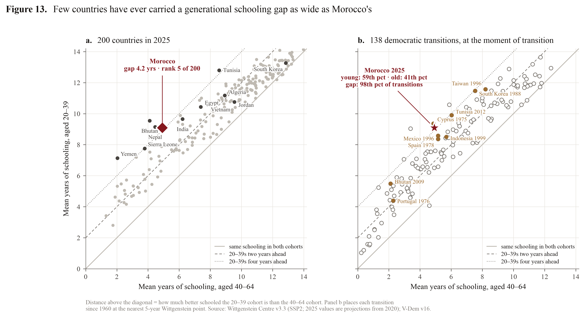{width=100%}

In 2025, Moroccans aged 20–39 average 9.1 years of schooling; those aged 40–64 average 4.9. The gap of 4.2 years is the **fifth largest of 200 countries**. Only Bhutan (5.4), Yemen (5.1), Nepal (4.7) and Tunisia (4.2, marginally larger) exceed it, against a world median of 1.5 years (Table 14, Figure 13a). Measured as the difference in the share who never went to school (42.5% of the old against 10.4% of the young), the gap is 32 points, sixth in the world.

Panel b places Morocco in the space of the 138 democratic transitions since 1960, each at its moment of transition. Compared with the young of those countries, Morocco's young are **average**: 59th percentile in mean years, and a slightly larger unschooled share than the median (10.4% against 8.5%). Morocco's old are **below average**: 41st percentile in mean years, 71st percentile in unschooled share (42.5% against 22.2%). What is exceptional is the distance between the two. The median transition occurred with a generational gap of 2.1 years; Morocco's exceeds that of **98% of all transitions**.

**Table 14. The generational schooling gap in 2025 (mean years of schooling; WCDE v3.3, SSP2)**

| Country      |   MYS 20–39 |   MYS 40–64 |   Gap (yrs) |   Rank of 200 |   % none, 40–64 |
|:-------------|------------:|------------:|------------:|-------:|---------------:|
| Bhutan       |         9.5 |         4.1 |         5.4 |      1 |           51.1 |
| Yemen        |         7.1 |         2.0 |         5.1 |      2 |           82.9 |
| Nepal        |         9.1 |         4.5 |         4.7 |      3 |           45.2 |
| Tunisia      |        12.8 |         8.6 |         4.2 |      4 |           15.8 |
| **Morocco**  |     **9.1** |     **4.9** |     **4.2** |  **5** |       **42.5** |
| Sierra Leone |         7.8 |         3.8 |         4.0 |      6 |           62.7 |
| Egypt        |        10.4 |         7.4 |         3.0 |     18 |           29.5 |
| Vietnam      |        10.6 |         7.8 |         2.8 |     23 |            4.6 |
| Algeria      |        11.2 |         8.9 |         2.2 |     43 |           16.8 |
| Jordan       |        10.8 |         9.6 |         1.2 |    117 |            9.4 |
| Spain        |        11.9 |        10.9 |         1.0 |    132 |            0.8 |
| Taiwan       |        13.2 |        12.3 |         0.8 |    149 |            0.1 |
| South Korea  |        13.3 |        12.8 |         0.4 |    179 |            0.3 |

*Full table, with 25 countries: `tables/T14_generational_gap.csv`.*

The comparison with the countries that motivated the original doubt is instructive. Korea, Taiwan and Spain today have almost no generational gap: their schooling revolutions are complete. When they democratised, their gaps were 4.1 (Korea 1988), 3.3 (Taiwan 1996) and 3.0 years (Spain 1978), wide enough to create a generational political cleavage. Morocco carries that cleavage now, with an older generation far less schooled than theirs was.

### 3.2 Education pyramids

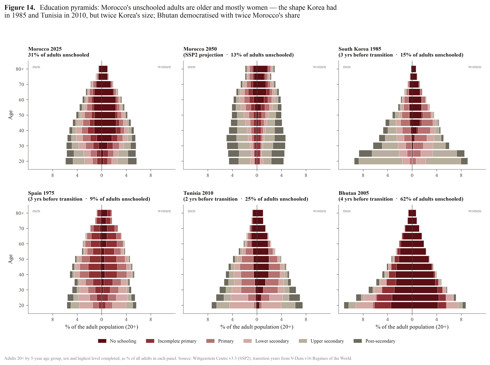{width=100%}

The education pyramid, the standard Wittgenstein Centre representation, shows the shape behind the numbers (Figure 14). Morocco's unschooled adults are concentrated above age 40 and overwhelmingly among women. The shape is the one Korea had in 1985 and Tunisia in 2010, three and two years respectively before their transitions. The *magnitude* differs: 31% of Moroccan adults (20+) are unschooled, against 15% in Korea in 1985 and 25% in Tunisia in 2010. Bhutan democratised with twice Morocco's share, 62% in 2005. By 2050 the Moroccan pyramid (SSP2) is capped by an unschooled residue of old women and is otherwise a secondary-and-tertiary pyramid.

### 3.3 A late schooling revolution

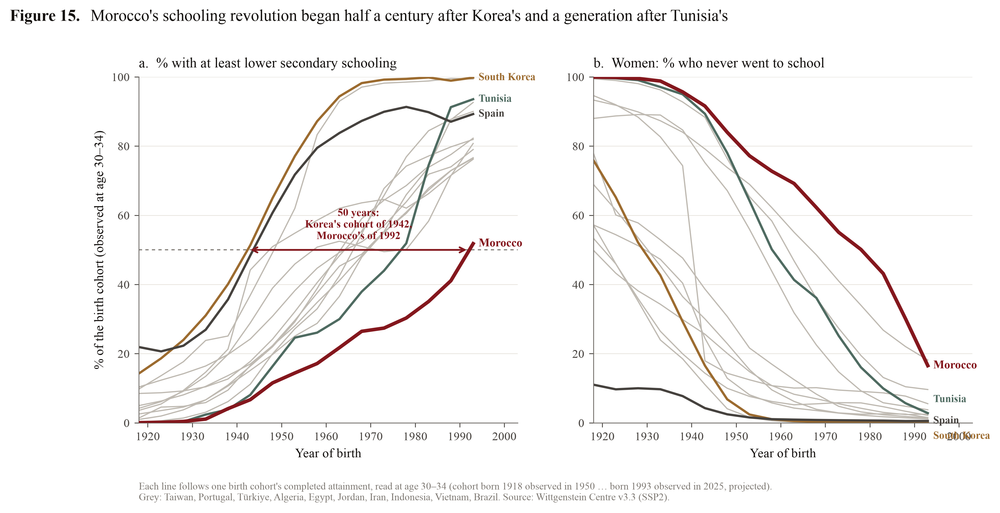{width=100%}

Following each birth cohort's attainment, read at age 30–34, dates the schooling revolution itself (Figure 15, Table 15). The first Moroccan birth cohort in which a majority completed at least lower secondary was **born in 1992**. The equivalent cohorts were born in 1942 in Korea, 1944 in Spain, 1948 in Taiwan, 1947 in Jordan, 1966 in Algeria, 1969 in Egypt, Iran and Indonesia, and 1977 in Tunisia. **Among Moroccan women, no cohort has yet crossed the threshold**: 49% of women born in 1993 completed lower secondary. The first cohort in which fewer than a quarter never went to school was born in 1987. Among women, the unschooled share was still above 40% for cohorts born in the early 1980s (Figure 15b).

**Table 15. First birth cohort to reach each threshold (attainment at age 30–34; WCDE v3.3)**

| Country     | No schooling < 25%   | ≥ lower secondary ≥ 50%   | Women: ≥ lower secondary ≥ 50%   | ≥ upper secondary ≥ 50%   | Lag behind Morocco (yrs)   |
|:------------|:---------------------|:---------------------|:----------------------------|:---------------------|:-----------------------|
| **Morocco** | **1987**             | **1992**             | **not yet (49%)**           | **not yet (35%)**    | —                      |
| South Korea | 1935                 | 1942                 | 1947                        | 1951                 | 50                     |
| Spain       | before 1918          | 1944                 | 1946                        | 1963                 | 49                     |
| Jordan      | 1942                 | 1947                 | 1947                        | 1957                 | 45                     |
| Taiwan      | 1925                 | 1948                 | 1952                        | 1956                 | 44                     |
| Vietnam     | 1927                 | 1957                 | 1978                        | 1993                 | 35                     |
| Türkiye     | 1937                 | 1963                 | 1971                        | 1980                 | 29                     |
| Portugal    | 1941                 | 1964                 | 1962                        | 1976                 | 28                     |
| Algeria     | 1967                 | 1966                 | 1970                        | 1982                 | 26                     |
| Egypt       | 1979                 | 1969                 | 1975                        | 1972                 | 23                     |
| Tunisia     | 1966                 | 1977                 | 1979                        | 1986                 | 15                     |
| Bhutan      | 1990                 | 1986                 | 1987                        | not yet (30%)        | 6                      |

This dating recasts the East Asian comparison. The relevant difference between Morocco and Korea is not a level of schooling at a point in time. It is half a century in the timing of mass secondary schooling. Paglayan (2021) shows, over 200 years and 109 countries, that democratisation had little or no effect on primary enrolment. Primary schooling often expanded before democracy, serving autocrats' own goals of nation-building and the promotion of loyalty. Morocco's late expansion under a stable monarchy fits that pattern. It also means that the democratic dividends of schooling, whatever they are, are only now arriving in the adult population.

### 3.4 Cohort trajectories and the timing of transitions

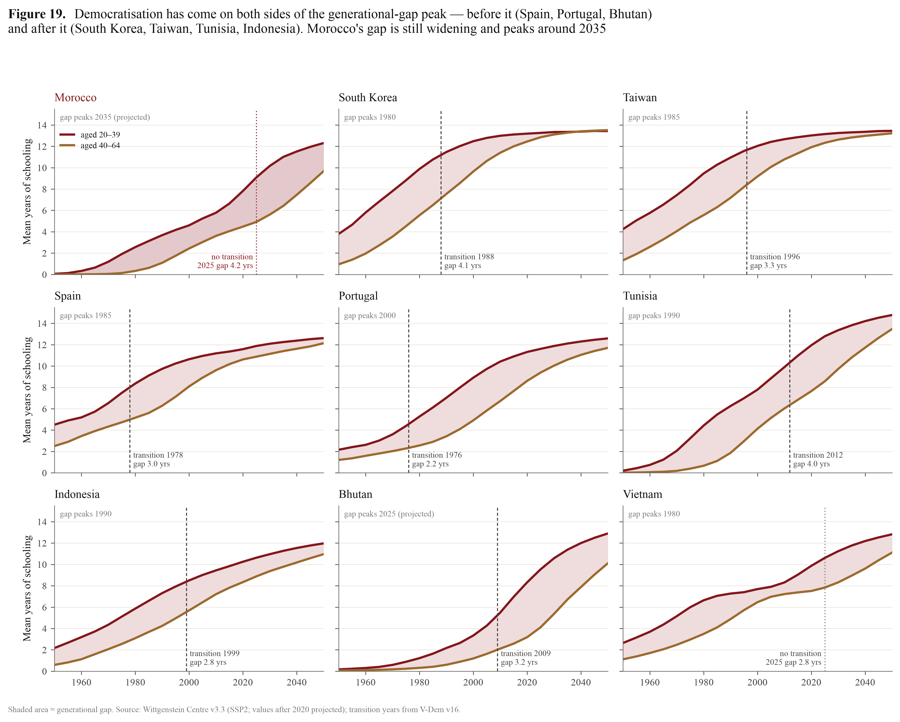{width=100%}

Did transitions happen when the generational gap peaked? Not systematically (Figure 19). Spain, Portugal and Bhutan democratised *before* their gaps peaked; Korea, Taiwan, Indonesia and Tunisia *after*. Transitions occurred with gaps ranging from 2.2 years (Portugal 1976) to 4.1 years (Korea 1988). Morocco's gap is still widening: it peaks around 2035 on the central projection, as the 1990s and 2000s cohorts enter the 20–39 band while the unschooled cohorts of the 1960s still make up the 40–64 band.

### 3.5 Morocco's historical twins

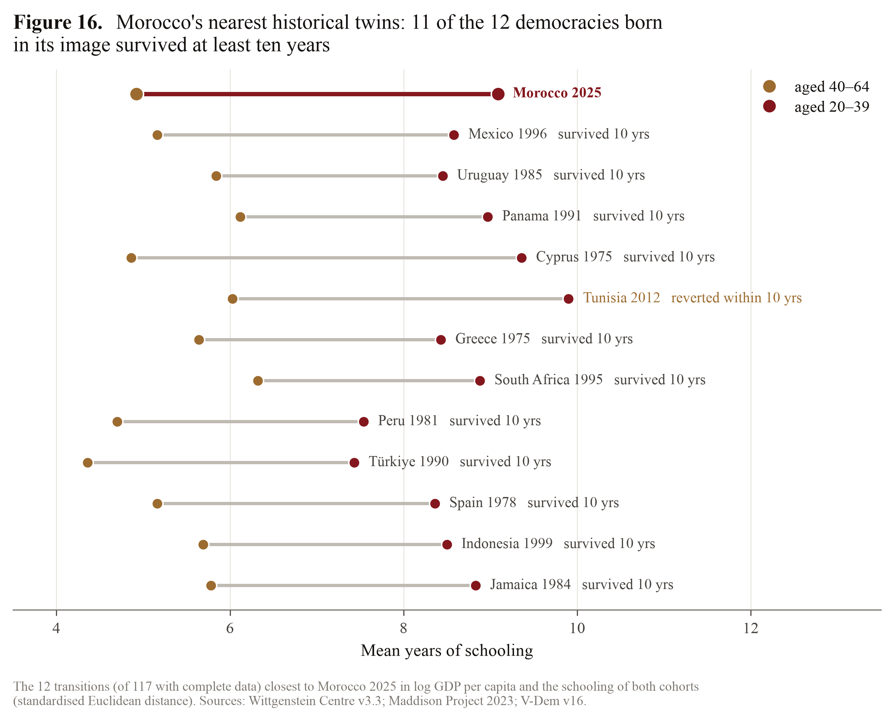{width=100%}

Which democratisers looked most like Morocco does today? The 12 transitions nearest to Morocco 2025 were identified in the joint space of log GDP per capita, the schooling of the young and the schooling of the old, using standardised Euclidean distance. They are Mexico 1996, Uruguay 1985, Panama 1991, Cyprus 1975, Tunisia 2012, Greece 1975, South Africa 1995, Peru 1981, Türkiye 1990, Spain 1978, Indonesia 1999 and Jamaica 1984 (Table 16, Figure 16). **Eleven of the twelve democracies survived at least ten years**; only Tunisia's did not. Cyprus 1975 is the closest match on the cohort profile: a generational gap of 4.5 years, and 39% of 40–64-year-olds unschooled against Morocco's 42%.

**Table 16. Morocco's nearest historical twins (N = 117 transitions with complete data)**

| Country      |   Transition |   GDP pc (Maddison) |   MYS 20–39 |   MYS 40–64 |   % none, 40–64 | Survived 10 yrs   |   Distance |
|:-------------|-------------:|--------------------:|------------:|------------:|---------------:|:---------------|-----------:|
| **Morocco 2025** |              |         **8,400** |    **9.09** |    **4.92** |      **42.5** | —              |       0.00 |
| Mexico       |         1996 |            10,386 |        8.58 |        5.16 |          24.5 | yes            |       0.30 |
| Uruguay      |         1985 |             8,901 |        8.45 |        5.84 |           5.8 | yes            |       0.35 |
| Panama       |         1991 |             7,659 |        8.97 |        6.12 |          18.1 | yes            |       0.38 |
| Cyprus       |         1975 |             5,528 |        9.36 |        4.86 |          39.0 | yes            |       0.48 |
| Tunisia      |         2012 |            10,751 |        9.90 |        6.03 |          33.5 | no             |       0.51 |
| Greece       |         1975 |            12,309 |        8.43 |        5.64 |          14.4 | yes            |       0.53 |
| South Africa |         1995 |             6,406 |        8.88 |        6.32 |          25.2 | yes            |       0.53 |
| Peru         |         1981 |             6,921 |        7.54 |        4.70 |          30.7 | yes            |       0.54 |
| Türkiye      |         1990 |             8,606 |        7.43 |        4.36 |          23.4 | yes            |       0.56 |
| Spain        |         1978 |            13,569 |        8.36 |        5.16 |           7.1 | yes            |       0.59 |
| Indonesia    |         1999 |             5,187 |        8.50 |        5.69 |          22.0 | yes            |       0.62 |
| Jamaica      |         1984 |             5,059 |        8.83 |        5.78 |           3.0 | yes            |       0.63 |

The comparison does not say these countries' democratisation was *caused* by their profile. It says that the combination of income and cohort schooling Morocco has today has repeatedly coexisted with democracies that lasted.

### 3.6 The unschooled stock is female

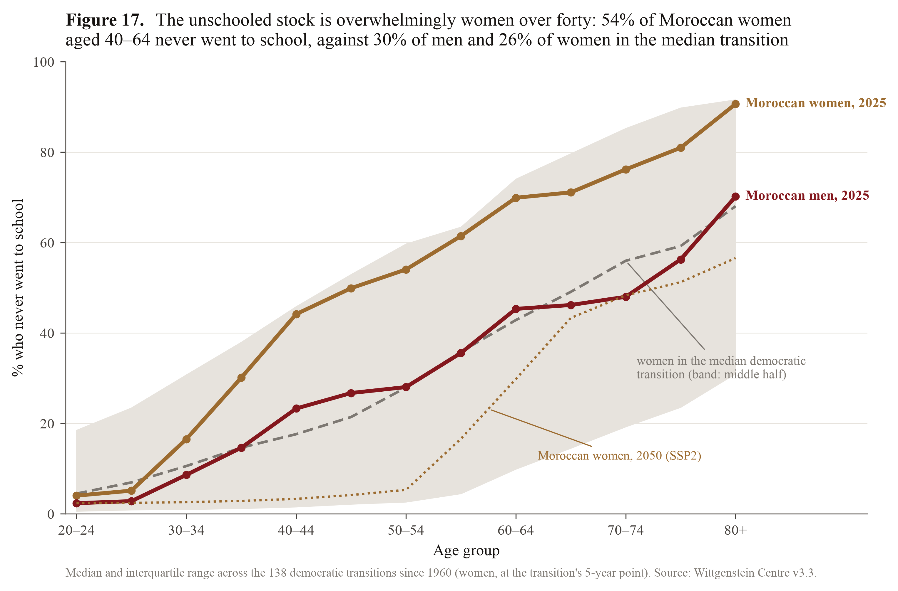{width=100%}

Disaggregating by sex locates the stock precisely (Table 17, Figure 17):

- **54% of Moroccan women aged 40–64 never went to school**, against 30% of Moroccan men of the same age and 26% of women in the median democratic transition (75th percentile).
- Among women aged 65 and over the share is 77%.
- Among women aged 20–39 it is 14%, still above the transition median for young women (9%).

The male–female gap in the share with at least primary schooling (adults 25+) is 16.5 points, against 6.7 at the median transition (80th percentile). Barro (1999) found exactly this gap to be a negative predictor of democracy, and Section 5.2 re-estimates that result.

**Table 17. Morocco 2025 by sex and age against the median democratic transition (% who never went to school)**

| Age band | Morocco, women | Morocco, men | Transitions: median, women | Transitions: median, men | Morocco women: percentile |
|:---|---:|---:|---:|---:|---:|
| 20–39 | 13.9 | 7.0 | 8.9 | 5.6 | 61 |
| 40–64 | **54.4** | 30.4 | 26.4 | 17.5 | **75** |
| 65+ | 77.4 | 51.3 | 56.9 | 37.9 | 72 |
| 25+ | 44.0 | 24.8 | 21.8 | 14.7 | 74 |

---

## 4. Demographic metabolism: a predetermined schedule

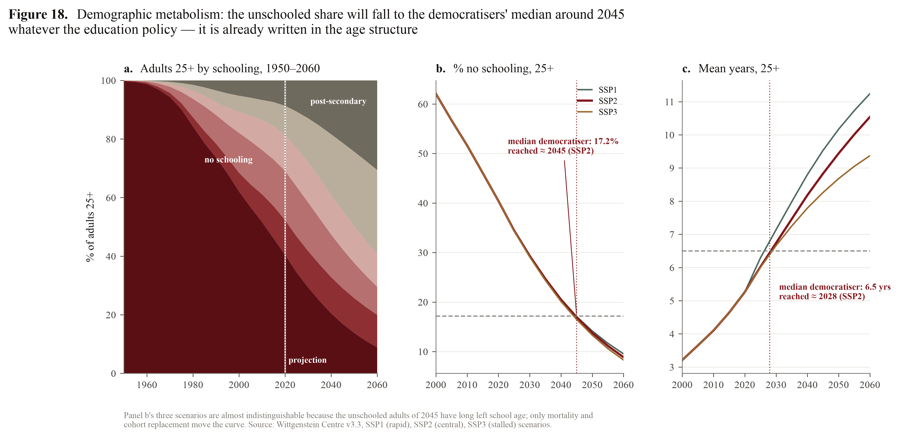{width=100%}

Lutz's (2013) theory of demographic metabolism predicts social change from the replacement of cohorts whose characteristics are fixed early in life. Educational attainment is the cleanest such characteristic: an adult's schooling is settled by age 25–30. For Morocco the theory yields a set of dates (Table 18, Figure 18):

- the unschooled share of adults 25+ reaches the median democratiser's level (17.2%) around **2044–45**;
- the unschooled share of 40–64-year-olds reaches its transition median (22.2%) around **2039**;
- mean years of adults 25+ reach the transition median (6.5 years) between **2026 and 2029**;
- the share of adults 20+ with at least lower secondary reaches its transition median (40.9%) between **2023 and 2026**.

The first two dates are **identical under all three scenarios**, SSP1, SSP2 and SSP3, to within a year. They depend only on the mortality and ageing of cohorts that left school long ago. Nothing education policy does today can move them. Mean years *is* scenario-dependent, because it incorporates the schooling of cohorts still in the system.

**Table 18. The year Morocco's adult population reaches the median democratic transition, by scenario**

| Benchmark (median at transition) | Threshold | Morocco 2020 | SSP1 | SSP2 | SSP3 |
|:---|---:|---:|---:|---:|---:|
| % no schooling, 25+ | 17.2 | 40.4 | 2045 | 2045 | 2044 |
| % no schooling, 40–64 | 22.2 | 47.7 | 2039 | 2039 | 2039 |
| Mean years, 25+ | 6.5 | 5.3 | 2026 | 2028 | 2029 |
| % ≥ lower secondary, 20+ | 40.9 | 35.3 | 2023 | 2025 | 2026 |

The replacement arithmetic is fast. On the central projection:

- 11% of Moroccan adults (20+) in 2030 will be people who are under 20 today;
- 22% in 2035;
- 31% in 2040;
- 46% in 2050.

Almost half of the adult population of 2050 has not yet reached adulthood. The educational "constraint" is, in the strict sense, a stock that is being retired on a known schedule.

---

## 5. Which education predicts democracy? Replications on current data

### 5.1 The margin of education

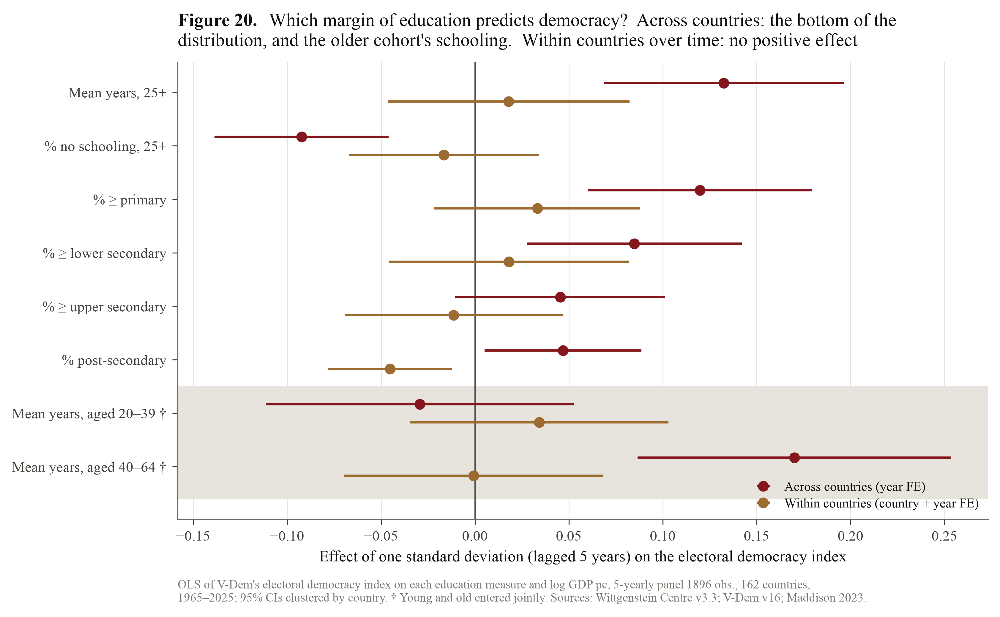{width=100%}

The first analysis replicated the finding of Acemoglu et al. (2005) that the cross-country correlation between education and democracy vanishes once country fixed effects absorb persistent national characteristics. The WCDE data allow the same exercise for each *margin* of the attainment distribution, in a 5-yearly panel of 162 countries, 1965–2025 (Table 20, Figure 20). Each regression has the V-Dem electoral democracy index at *t* on the left, and on the right the education measure at *t* − 5 (standardised), log GDP per capita at *t* − 5 and year effects. Three results emerge.

1. **Across countries, the bottom margin carries the correlation.** A one-standard-deviation higher share with at least primary schooling predicts a 0.12 higher index. A one-SD higher unschooled share predicts a 0.09 lower index. Upper secondary (0.045, not significant) and post-secondary (0.047) matter much less. This is the pattern Murtin and Wacziarg (2014) found over 1870–2000, and Castelló-Climent's (2008) "education of the majority".
2. **Within countries over time, nothing positive survives.** With country and year fixed effects, no margin has a significant positive coefficient. Post-secondary expansion is *negatively* associated with subsequent democracy (−0.045, p < 0.01), consistent with Paglayan's (2021) reminder that autocracies expand schooling for their own purposes.
3. **Entered together, the older cohort's schooling carries the cross-country correlation.** The coefficient on mean years of 40–64-year-olds is 0.170 (p < 0.01) and that on 20–39-year-olds is −0.029 (not significant). The level of democracy a country sustains tracks the education of its established adult population, not that of its most recent cohorts.

**Table 20. Which margin of education predicts democracy? (one-SD effects on the electoral democracy index; SEs clustered by country; N = 1,896)**

| Education measure (t − 5) | Pooled, year FE | Dynamic (lagged democracy) | Two-way FE |
|:---|:---|:---|:---|
| Mean years, 25+ | 0.133*** (0.033) | 0.016*** (0.005) | 0.018 (0.033) |
| % no schooling, 25+ | −0.092*** (0.024) | −0.014*** (0.003) | −0.016 (0.026) |
| % ≥ primary, 25+ | 0.120*** (0.031) | 0.015*** (0.004) | 0.033 (0.028) |
| % ≥ lower secondary, 25+ | 0.085*** (0.029) | 0.009** (0.004) | 0.018 (0.033) |
| % ≥ upper secondary, 25+ | 0.045 (0.028) | 0.004 (0.004) | −0.011 (0.030) |
| % post-secondary, 25+ | 0.047** (0.021) | 0.001 (0.002) | −0.045*** (0.017) |
| Young (20–39) and old (40–64), jointly | young −0.029; old 0.170*** | young 0.005; old 0.014* | young 0.034; old −0.001 |

*\*\*\* p < 0.01, \*\* p < 0.05, \* p < 0.1. The fourth specification (two-way FE with lagged democracy) is in `tables/T20_which_margin.csv`.*

### 5.2 Barro (1999) revisited

Barro's (1999) panel of over 100 countries, 1960–1995, found that democracy rises with income, primary schooling and a smaller male–female gap in primary attainment. Re-estimating his dynamic specification with WCDE attainment and V-Dem v16 over 1965–2025 (Table 21):

- **Primary attainment:** each 10 points of adults with at least primary schooling raises the index by 0.004 per five years (p < 0.01).
- **The gender gap:** each 10 points of male–female gap lowers it by 0.007 (p = 0.012). Both are short-run effects, with a lagged-democracy coefficient of 0.90.
- **Robustness:** the gender-gap effect weakens when urbanisation and resource rents are added, and **disappears with country fixed effects** (−0.001, p = 0.82).
- **Income:** it does not enter significantly in any specification.
- **Monarchy:** adding a ruling-monarchy indicator leaves the education results intact and itself enters at −0.035 per five years (p < 0.001).

Morocco's gender gap (16.5 points) would, on the Barro coefficient, cost about 0.007 in the short run relative to the median transition's 6.7 points. That is a small number next to the institutional terms.

**Table 21. Barro (1999) on WCDE v3.3 and V-Dem v16 (dependent variable: electoral democracy index at t; 5-yearly, year FE)**

| Variable | (1) Barro specification | (3) + country FE | (4) + ruling monarchy |
|:---|:---|:---|:---|
| Democracy, t − 5 | 0.898*** (0.015) | 0.647*** (0.030) | 0.886*** (0.016) |
| log GDP pc, t − 5 | 0.002 (0.004) | −0.006 (0.010) | 0.005 (0.004) |
| % ≥ primary, 25+ (per 10 pts) | 0.004*** (0.001) | 0.006* (0.003) | 0.003** (0.001) |
| Male − female gap, % ≥ primary (per 10 pts) | −0.007** (0.003) | −0.001 (0.006) | −0.007** (0.003) |
| Ruling monarchy, t − 5 | | | −0.035*** (0.010) |
| N / countries | 1,896 / 162 | 1,896 / 162 | 1,896 / 162 |

---

## 6. The hazard of transition and the monarchical constraint

### 6.1 Who ever becomes a democracy?

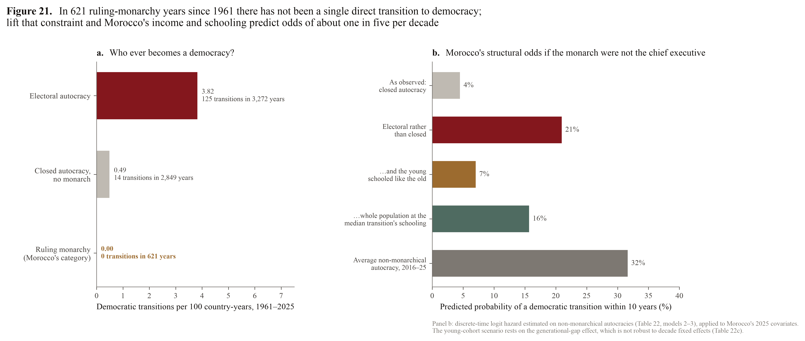{width=100%}

A level regression answers "how democratic?" The question for Morocco is "how likely is a transition?", which calls for a hazard model: the annual probability that an autocracy becomes an electoral democracy, given that it has not yet done so (Przeworski et al. 2000). The risk set consists of all autocracy-years 1961–2025, and it is strikingly heterogeneous (Table 22a):

- electoral autocracies transition at 3.8 per 100 country-years;
- closed autocracies without a ruling monarch at 0.5;
- **ruling monarchies — 621 country-years in 17 countries, Morocco among them — have produced zero transitions.**

The zero is partly definitional and wholly informative. V-Dem requires the chief executive of an electoral democracy to be chosen through elections, directly or by an elected legislature. A monarch who remains the chief executive therefore cannot preside over an electoral democracy. Every monarchy that democratised did so after executive authority had passed to a government answerable to parliament. Bhutan's transfer came in 2008, a year before its transition, and Lesotho's in 1991, two years before. Nepal's transfers of 1990 and 2006 were followed by an electoral autocracy and then by the abolition of the monarchy. The monarchical question is thus not one variable among others in the hazard. It is the gate.

**Table 22a. The risk set, 1961–2025**

| Autocracy type (t − 1) | At-risk years | Transitions | Countries | Transitions per 100 years |
|:---|---:|---:|---:|---:|
| Electoral autocracy | 3,272 | 125 | 131 | 3.82 |
| Closed autocracy, non-monarchical | 2,849 | 14 | 130 | 0.49 |
| **Ruling monarchy** | **621** | **0** | **17** | **0.00** |

### 6.2 What predicts transitions among non-monarchical autocracies?

Because ruling-monarchy years never end in a same-year transition, the hazard is estimated on non-monarchical autocracies: 5,146 country-years and 117 transitions. It is a logit with covariates lagged one year, log spell duration and a trend (Carter and Signorino 2010). Standard errors are clustered by country (Table 22).

- **Income does not predict the timing of transitions** (odds ratio 0.96, p = 0.80), the core empirical claim of Przeworski et al. (2000). It is consistent with Treisman's (2020) view that development predisposes, but that transitions need triggers.
- **Regime type does.** A closed autocracy's odds of transition are one-fifth of an electoral autocracy's (odds ratio 0.19, p < 0.001).
- **Diffusion matters.** Ten more percentage points of democracies in the region raise the odds by 13% (p = 0.02), as in Gleditsch and Ward (2006). Morocco's region has the lowest share of democracies of any.
- **Education enters through its distribution.** Each 10 points of unschooled adults lower the odds by 20% (p < 0.01).
- **Cohorts pull in opposite directions.** Split by cohort, the young cohort's schooling raises the odds (odds ratio 1.34 per year, p < 0.01) while the old cohort's does not (0.84, p = 0.07). Equivalently, each year of generational gap raises the odds by 27% (p < 0.01).

The generational-gap result is an important qualification of Section 5.1: levels of democracy track the old; *transitions* track the young. It is also the most fragile result in this paper (Table 22c). It survives region fixed effects and the exclusion of sub-Saharan Africa. It does not survive decade fixed effects, the restriction to 1990–2025, or re-measurement as a difference in unschooled shares. The effect is identified mainly *across eras*: the transitions of the 1970s and 1980s in Southern Europe, Latin America and East Asia occurred with wide gaps. It should be read as suggestive, not as a structural parameter.

**Table 22. Discrete-time hazard of democratic transition, non-monarchical autocracies 1961–2025 (logit coefficients)**

| Variable (t − 1) | (2) Regime type, diffusion | (3) Young vs old | (4) Level + gap | (5) Distribution |
|:---|:---|:---|:---|:---|
| log GDP pc | −0.040 (0.158) | −0.163 (0.165) | −0.132 (0.163) | −0.027 (0.138) |
| Mean years, 25+ | 0.094 (0.060) | | 0.115* (0.061) | |
| Mean years, 20–39 | | 0.295*** (0.097) | | |
| Mean years, 40–64 | | −0.171* (0.094) | | |
| Generational gap (yrs) | | | 0.239*** (0.092) | |
| % no schooling, 25+ | | | | −0.023*** (0.008) |
| % ≥ upper secondary, 25+ | | | | −0.011** (0.006) |
| Closed autocracy | −1.651*** (0.315) | −1.643*** (0.324) | −1.632*** (0.322) | −1.702*** (0.321) |
| % democracies in region | 0.012** (0.005) | 0.014*** (0.005) | 0.014*** (0.005) | 0.011** (0.005) |
| At-risk years / transitions | 5,146 / 117 | 5,146 / 117 | 5,146 / 117 | 5,146 / 117 |

*All models include log spell duration and a decade trend. Models 1 and 6 are in `tables/T22_hazard.csv`.*

**Table 22c. Robustness of the generational-gap effect**

| Specification | Odds ratio | p | At-risk years | Transitions |
|:---|---:|---:|---:|---:|
| Baseline (model 4) | 1.27 | 0.009 | 5,146 | 117 |
| Region fixed effects | 1.33 | 0.005 | 5,146 | 117 |
| Excluding sub-Saharan Africa | 1.34 | 0.020 | 3,022 | 78 |
| Decade fixed effects | 1.13 | 0.262 | 5,146 | 117 |
| 1990–2025 only | 1.03 | 0.813 | 2,498 | 93 |
| Gap in % no schooling | 1.00 | 0.949 | 5,146 | 117 |

### 6.3 Morocco's structural hazard

Applying the model to Morocco's 2025 covariates asks what its income, schooling, regional context and regime type would predict *if the monarch were not the chief executive* (Table 23, Figure 21b).

- **As a closed autocracy:** 0.5% a year, 4.5% over a decade.
- **As an electoral autocracy** — which is what Morocco would be if the head of government were accountable to its multiparty parliament — **2.4% a year and 21% over a decade**, against 32% for the average non-monarchical autocracy of 2016–25.
- **With the young schooled like the old:** the decade probability falls to 7%.
- **With the whole population at the schooling of the median transition:** 16%.

A decomposition of the log-odds gap between Morocco and the average non-monarchical autocracy-year of 2016–25 (Table 23b) attributes:

- −1.31 to closed-autocracy status;
- −0.48 to the regional environment;
- −0.31 to spell duration;
- essentially nothing to income.

Education *adds* to Morocco's hazard through the generational gap (+0.37), subject to the fragility noted above. Nothing in the decomposition points to the education stock as what holds the hazard down.

**Table 23. Morocco's structural hazard in 2025 (models 2–3 of Table 22)**

| Morocco, if the monarch were not the chief executive | Annual hazard (%) | P(transition within 10 years) (%) |
|:---|---:|---:|
| As observed: closed autocracy | 0.5 | 4.5 |
| Electoral rather than closed autocracy | 2.4 | 21.0 |
| … and the young schooled like the old | 0.7 | 7.0 |
| … whole population at the median transition's schooling | 1.7 | 15.7 |
| Reference: average non-monarchical autocracy, 2016–25 | 3.7 | 31.6 |

### 6.4 The royal reference class

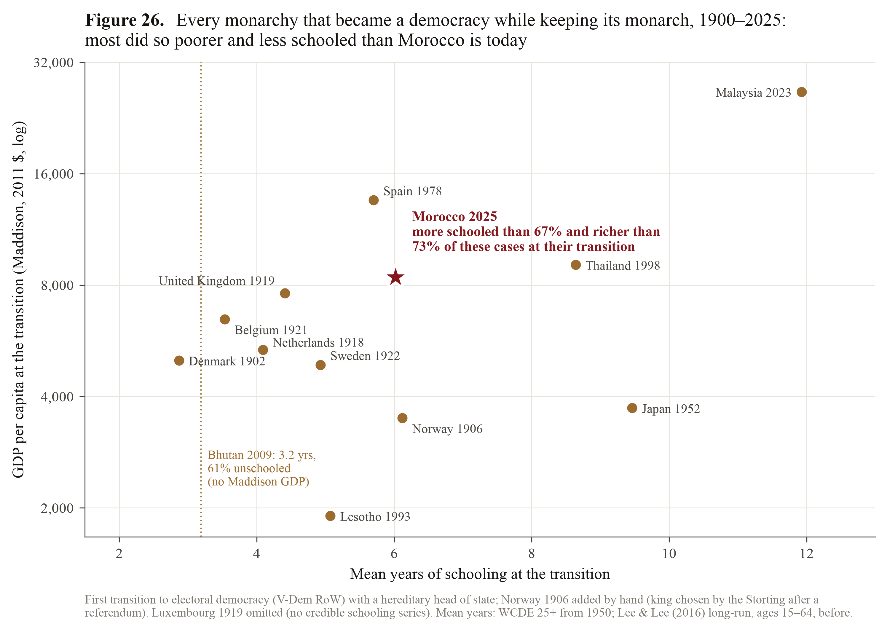{width=100%}

If the gate is the transfer of executive power, the relevant precedents are the monarchies that became democracies while keeping the monarch. V-Dem identifies 13 first transitions to electoral democracy with a hereditary head of state since 1900: Denmark 1902, Norway 1906, the Netherlands 1918, the United Kingdom and Luxembourg 1919, Belgium 1921, Sweden 1922, Japan 1952, Spain 1978, Lesotho 1993, Thailand 1998, Bhutan 2009 and Malaysia 2023 (Table 19, Figure 26).

**Morocco today is more schooled than eight of the twelve with schooling data, and richer than eight of the eleven with income data.** The median royal democratisation occurred at about 5.0 mean years of schooling and a GDP per capita of $5,343 (Maddison, 2011 prices). Morocco has 6.0 years and $8,400.

The exceptions are instructive:

- **Richer and more schooled:** Japan 1952 (at the end of the Allied occupation), Thailand 1998 and Malaysia 2023.
- **Poorer and less schooled than Morocco by a wide margin:** Bhutan 2009, a king-initiated transition with 61% of adults unschooled.

The one dimension on which the European monarchies clearly outranked Morocco is basic literacy. Belgium had 92% adult literacy in 1920, against Morocco's 64% (WDI, latest year 2014). This is the same distributional point again: early-twentieth-century Europe had short but *universal* schooling, whereas Morocco combines a substantial secondary-educated population with a large unschooled one.

**Table 19. Monarchies that became democracies while keeping the monarch**

| Country | Year | GDP pc (Maddison) | Mean years† | % none, 25+ | Adult literacy % |
|:---|---:|---:|---:|---:|---:|
| Denmark | 1902 | 5,007 | 2.9 | | |
| Norway | 1906 | 3,496 | 6.1 | | |
| Netherlands | 1918 | 5,343 | 4.1 | | |
| United Kingdom | 1919 | 7,605 | 4.4 | | |
| Luxembourg | 1919 | | | | |
| Belgium | 1921 | 6,465 | 3.5 | | 92.2 |
| Sweden | 1922 | 4,868 | 4.9 | | |
| Japan | 1952 | 3,724 | 9.5 | 4.5 | 97.5 |
| Spain | 1978 | 13,569 | 5.7 | 8.3 | 92.8 |
| Lesotho | 1993 | 1,904 | 5.1 | 22.7 | 86.3 |
| Thailand | 1998 | 9,078 | 8.6 | 6.0 | 92.7 |
| Bhutan | 2009 | | 3.2 | 61.0 | 55.3 |
| Malaysia | 2023 | 26,629 | 11.9 | 6.3 | 95.8 |
| **Morocco** | **2025** | **8,400** | **6.0** | **34.5** | **64.3** |

*† WCDE 25+ from 1950; Lee and Lee (2016) long-run series, ages 15–64, before 1950 (the two bases are not strictly comparable). Norway 1906 is added by hand: Haakon VII was chosen by the Storting after the 1905 referendum, which V-Dem codes as an "other" path to office. Luxembourg's long-run series (0.2–0.6 years in 1900–30) is not credible and is omitted.*

---

## 7. The institutional anatomy of the deficit

### 7.1 Where the deficit sits

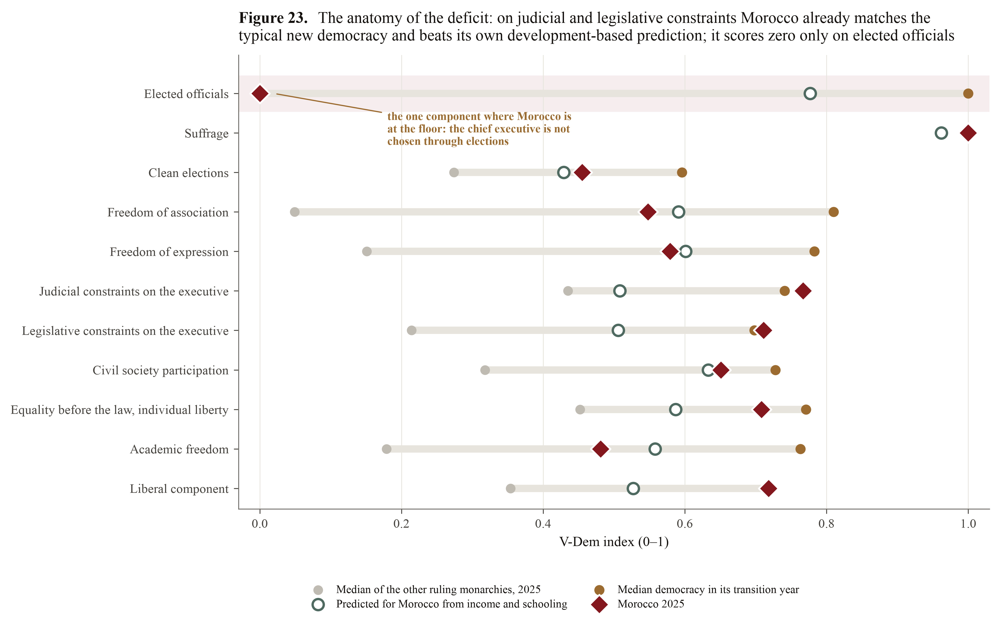{width=100%}

Morocco's electoral democracy index of 0.26 conceals a very uneven profile (Table 25, Figure 23). On **judicial constraints on the executive (0.77), legislative constraints (0.71) and the liberal component (0.72)**, Morocco already matches or exceeds the median democracy in its transition year (0.74, 0.70 and 0.72). It is far above the level its income and schooling predict (0.51–0.53).

On **clean elections (0.46)** it is above the median of the year *before* a transition (0.43) but below the transition year's (0.60). On **freedom of association (0.55), freedom of expression (0.58) and academic freedom (0.48)** it is roughly at the level its development predicts but well below the typical new democracy (0.81, 0.78 and 0.76).

And on **elected officials** it scores exactly zero. The chief executive is not chosen through elections, directly or indirectly. The other seven ruling monarchies score far lower than Morocco on almost everything else: their median freedom-of-association score is 0.05.

**Table 25. V-Dem v16 components, 2025**

| Component | Morocco 2025 | Predicted from income & schooling | Median, year before transition | Median, transition year | Median, other ruling monarchies |
|:---|---:|---:|---:|---:|---:|
| Elected officials | **0.00** | 0.78 | 1.00 | 1.00 | 0.00 |
| Suffrage | 1.00 | 0.96 | 1.00 | 1.00 | 1.00 |
| Clean elections | 0.46 | 0.43 | 0.43 | 0.60 | 0.27 |
| Freedom of association | 0.55 | 0.59 | 0.73 | 0.81 | 0.05 |
| Freedom of expression | 0.58 | 0.60 | 0.71 | 0.78 | 0.15 |
| Judicial constraints on the executive | 0.77 | 0.51 | 0.66 | 0.74 | 0.43 |
| Legislative constraints on the executive | 0.71 | 0.51 | 0.59 | 0.70 | 0.21 |
| Civil society participation | 0.65 | 0.63 | 0.67 | 0.73 | 0.32 |
| Equality before the law, individual liberty | 0.71 | 0.59 | 0.70 | 0.77 | 0.45 |
| Academic freedom | 0.48 | 0.56 | 0.69 | 0.76 | 0.18 |
| Liberal component | 0.72 | 0.53 | 0.59 | 0.72 | 0.35 |
| **Electoral democracy index** | **0.26** | 0.42‡ | 0.45 | 0.54 | 0.14 |

*‡ From the first analysis's cross-section regression on log income and schooling.*

### 7.2 The parliamentary-monarchy arithmetic

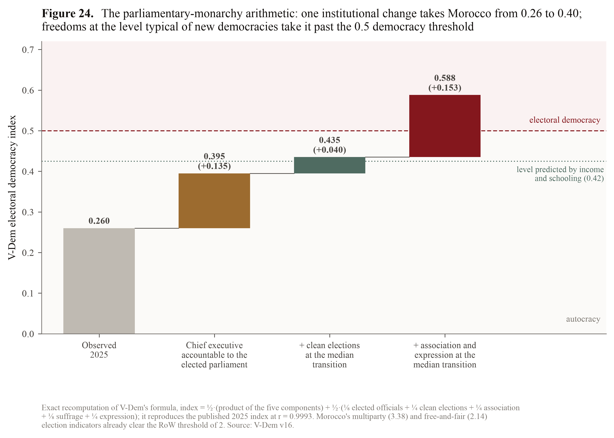{width=100%}

Because V-Dem publishes its aggregation formula, the counterfactual that motivates this study can be computed exactly rather than estimated. The electoral democracy index is

index = ½ × (product of the five components) + ½ × (⅛ elected officials + ¼ clean elections + ¼ association + ⅛ suffrage + ¼ expression).

Recomputed from the published components, the formula reproduces the published 2025 index for 179 countries at r = 0.9993 (mean absolute error 0.007). For Morocco it gives 0.260 against a published 0.259. Two properties of the formula drive everything:

- The product term is zero whenever any component is zero. With elected officials at zero, Morocco forfeits the entire multiplicative half of the index, whatever its freedoms.
- Morocco's multiparty (3.38) and free-and-fair (2.14) election indicators already clear the Regimes of the World threshold of 2 for an electoral democracy. What keeps Morocco in the *closed* autocracy category is not the quality of its elections but what they are elections *to*.

The counterfactuals (Table 26, Figure 24):

1. **A chief executive accountable to the elected parliament** (elected officials = 1, everything else unchanged) lifts the index from 0.26 to **0.395**. That is close to the 0.42 that income and schooling predict. The entire "education-adjusted" deficit identified in the first analysis would be closed by this single change, to within 0.03.
2. **Adding clean elections at the median transition's level** gives 0.435, still an electoral autocracy.
3. **Adding freedoms of association and expression at the median new democracy's level** gives **0.588, an electoral democracy**.

Equivalently, raising the three freedom components uniformly by 0.12 on V-Dem's 0–1 scale, from 0.46/0.55/0.58 to about 0.57/0.67/0.70, just reaches the 0.5 threshold. Freedoms at the level *predicted by income and schooling* would not suffice (0.404). New democracies typically have freedoms above what their development predicts, and Morocco would need the same.

**Table 26. Exact counterfactuals on V-Dem's aggregation formula**

| Scenario | Electoral democracy index | Regimes of the World category |
|:---|---:|:---|
| Observed (2025) | 0.260 | Closed autocracy (as coded) |
| 1. Chief executive accountable to the elected parliament | 0.395 | Electoral autocracy |
| 2. + clean elections at the median transition | 0.435 | Electoral autocracy |
| 3. + association and expression at the median transition | 0.588 | Electoral democracy |
| Alt. 2. + all three freedoms at the income-and-schooling prediction | 0.404 | Electoral autocracy |
| Alt. 3. + a uniform +0.118 on the three freedoms | 0.500 | Electoral democracy (threshold) |

This arithmetic describes the index, not politics. It says nothing about how such changes could come about or whether they would last. What it does establish is the order of magnitude of what separates Morocco from the democratic threshold: one institutional switch plus freedoms of roughly the level already found in the average new democracy. Neither involves the education stock.

### 7.3 The demographic-educational expectation

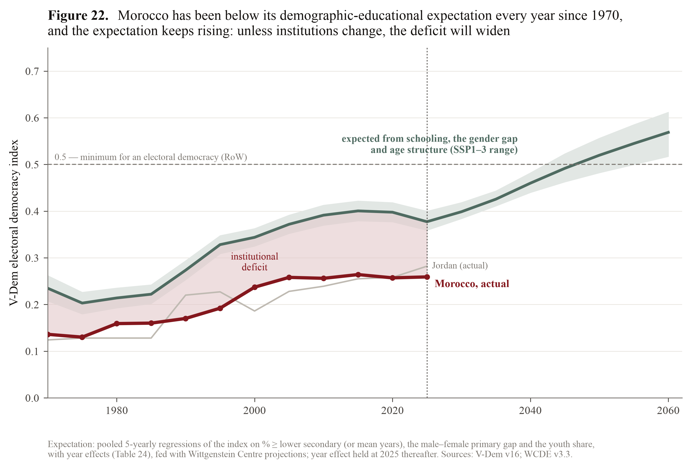{width=100%}

In the spirit of Lutz et al. (2010), a pooled 5-yearly model regresses the electoral democracy index on three variables with year effects, 1970–2025 (Table 24):

- attainment (share with at least lower secondary, or mean years);
- the male–female gap in primary attainment;
- the youth share of the adult population (Urdal 2006).

The gender gap (−0.006 per point) and the youth share (−0.011 per point) are robustly negative. Mean years is positive (0.026 per year). The lower-secondary share is not significant once the other two are controlled. Fed with WCDE projections and holding the year effect at its 2025 value, the model gives Morocco's **demographic-educational expectation** (Figure 22):

- 0.21–0.26 in 1970, against an actual 0.14;
- 0.25–0.29 in 1990, against 0.17;
- 0.36–0.39 in 2025, against 0.26;
- 0.45–0.47 in 2040 and 0.57 in 2060.

Morocco has been below its expectation in every year since 1970. The expectation keeps rising as the gender gap closes and the population ages, so an unchanged institutional configuration implies a widening deficit. In the logit version, the predicted probability of being an electoral democracy rises from 0.28 (2025) to 0.40 (2040) and 0.59 (2060).

**Table 24. A demographic-educational model of democracy (5-yearly pooled panel 1970–2025, year effects, SEs clustered by country)**

| Variable | (1) OLS, index | (2) OLS, index | (3) Logit, P(democracy) |
|:---|:---|:---|:---|
| % ≥ lower secondary, 25+ | 0.001 (0.001) | | 0.004 (0.007) |
| Mean years, 25+ | | 0.026*** (0.006) | |
| Male − female gap, % ≥ primary | −0.006*** (0.001) | −0.005*** (0.001) | −0.070*** (0.017) |
| Youth share (15–24 / 15+) | −0.011*** (0.003) | −0.007*** (0.003) | −0.082*** (0.027) |
| N / R² (pseudo-R²) | 1,926 / 0.376 | 1,926 / 0.401 | 1,926 / 0.229 |

---

## 8. Education, opportunity and mobilisation: Campante and Chor revisited

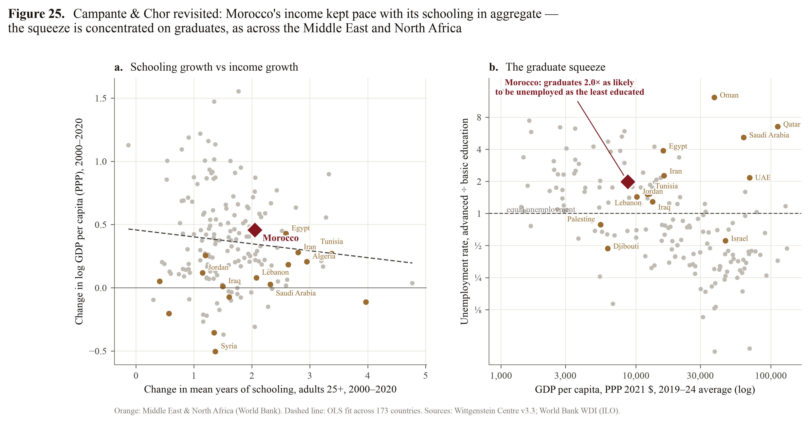{width=100%}

Campante and Chor (2012) argued that the Arab world was "poised for revolution" because schooling had expanded while labour-market opportunities had not. Their micro and macro evidence (Campante and Chor 2014) shows that educated individuals whose income falls short of what their characteristics predict are more likely to protest. Three tests on current data:

**Aggregate squeeze.** Between 2000 and 2020, Morocco's adult mean years rose by 2.05 years (76th percentile of 173 countries) and its log GDP per capita by 0.46 (65th percentile). Across countries the two changes are essentially unrelated; the slope is slightly negative. Morocco's income grew *more* than its schooling growth would predict (it sits at the 35th percentile of the "opportunity gap"), unlike most of its Middle Eastern and North African neighbours, which cluster in the high-schooling, low-growth quadrant (Figure 25a). At the aggregate level, Morocco is not in the Campante–Chor danger zone.

**The graduate squeeze.** Where the squeeze does appear is in the returns to schooling in the labour market. In 2022 the unemployment rate of Moroccans with advanced education was 25.9%, against 13.1% for those with basic education. That ratio of 2.0 puts Morocco at the 80th percentile of 171 countries; the world median is 0.8, meaning graduates are usually *less* exposed to unemployment. The pattern is regional: Egypt 3.9, Saudi Arabia 5.2, Iran 2.3, Tunisia 1.5 (Table 28, Figure 25b). Korea (0.8), Spain (0.4) and Portugal (0.7) show the opposite gradient.

**Mobilisation.** Regressing V-Dem's index of pro-democracy mass mobilisation (average 2011–25) on the 2000–20 changes in schooling and income, their interaction and initial conditions (Table 27):

- slower income growth predicts more mobilisation (−0.57, p < 0.1; −0.90, p < 0.05 among countries that were autocracies in 2000);
- schooling growth enters positively but imprecisely (0.24–0.27);
- the Campante–Chor interaction is not supported in these data (0.12, p = 0.79).

The mechanism may operate, as their micro evidence suggests, at the level of individuals and labour markets rather than national aggregates.

**Table 28. Unemployment by level of education (latest year 2015–2025; ILO via WDI)**

| Country | Year | Basic education % | Advanced education % | Ratio advanced ÷ basic | Percentile of ratio |
|:---|---:|---:|---:|---:|---:|
| **Morocco** | 2022 | 13.1 | 25.9 | **2.0** | **80** |
| Tunisia | 2023 | 14.2 | 21.7 | 1.5 | 70 |
| Egypt | 2024 | 3.4 | 13.2 | 3.9 | 92 |
| Jordan | 2023 | 18.6 | 26.6 | 1.4 | 68 |
| Iran | 2024 | 5.0 | 11.3 | 2.3 | 83 |
| Saudi Arabia | 2024 | 1.0 | 5.1 | 5.2 | 95 |
| Türkiye | 2024 | 7.4 | 9.1 | 1.2 | 64 |
| South Korea | 2025 | 3.4 | 2.7 | 0.8 | 53 |
| Spain | 2025 | 15.3 | 6.4 | 0.4 | 26 |
| Portugal | 2025 | 6.4 | 4.4 | 0.7 | 45 |
| World median (N = 171) | | 6.6 | 4.9 | 0.8 | 50 |

---

## 9. Micro evidence: do the two electorates want different things?

### 9.1 Morocco among 39 African publics

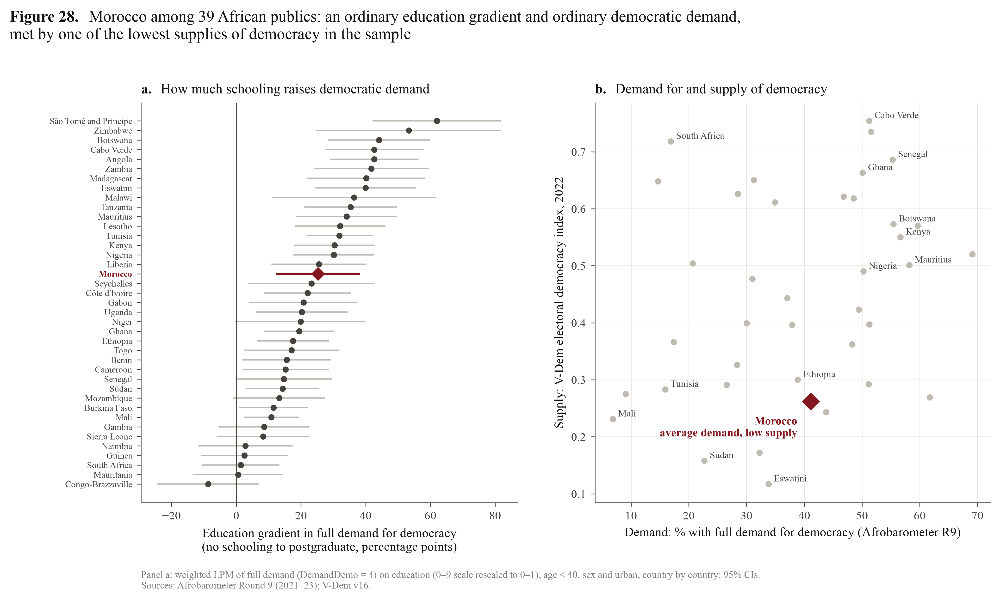{width=100%}

If Morocco's democratic deficit reflected a deficit of democratic *demand* — the intuition behind the original doubt — it should show up in survey data. It does not (Table 31, Figure 28).

- **Support:** 67.7% of Moroccans say democracy is preferable to any other kind of government, against a 39-country mean of 67.6%.
- **Full demand:** 41.1% hold all four democratic commitments of Afrobarometer's demand index — support for democracy plus rejection of one-party, military and one-man rule — against 38.8%.
- **Education gradient:** the difference in full demand between the unschooled and postgraduates is 25 points. That ranks 17th of 39 against a median of 21: an ordinary gradient.
- **Supply:** in Mattes and Bratton's (2007) terms, Morocco combines average demand with one of the lowest *supplies* of democracy in the sample.

One number is far from ordinary: self-reported turnout at the last national election (49.8%, against 72.9%) is the fifth lowest of the 39.

There is also no evidence here that education's effect on democratic attitudes is weaker in less democratic countries. Österman and Robinson (2023) report exactly that regime-conditionality in other survey data. In this sample, the pooled interaction between schooling and V-Dem's index is small and insignificant for all four outcomes.

### 9.2 Schooling and generation within Morocco

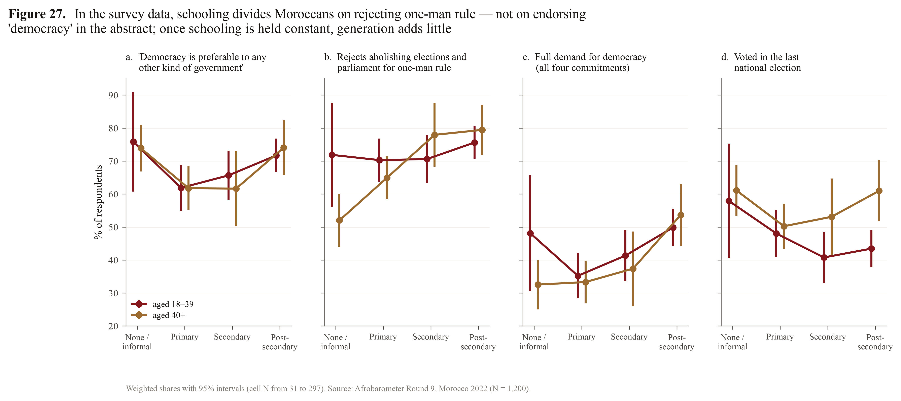{width=100%}

Within Morocco, schooling and generation do not divide democratic attitudes the way the two-electorates hypothesis would suggest (Tables 29–30, Figure 27).

- **Abstract support is U-shaped in schooling.** The unschooled and the post-secondary educated endorse democracy "in general" equally (about 74%); those with primary or secondary schooling somewhat less.
- **Rejection of one-man rule rises steeply with schooling.** The item asks about abolishing elections and parliament so that one leader decides everything. Holding age, sex, residence, employment, poverty and region constant, post-secondary respondents are 20 points more likely to reject it than the unschooled (p < 0.01), and 15 points more likely to hold full demand for democracy (p < 0.05). Among the 40+ generation, rejection rises from 52% for the unschooled to 80% for the post-secondary.
- **Generation adds little once schooling is held constant.** The 40–64 coefficient is zero for support, full demand and rejection of one-man rule. The young differ in *participation*, not attitudes: 18–39-year-olds are 8 points less likely to have voted and 4 points more likely to have protested. Women are 15 points less likely to have voted.

The deliberate-disengagement hypothesis of Croke et al. (2016) predicts that education lowers participation in electoral autocracies, because educated citizens see voting as futile or legitimising. It finds little support here. Post-secondary respondents are no less likely to vote than the unschooled (−2 points, not significant). Disengagement in Morocco is generational, not educational.

**Table 29. Democratic attitudes and participation by generation and schooling, Morocco 2022 (% weighted; Afrobarometer R9)**

| Generation | Schooling | N | Democracy always preferable | Rejects one-man rule | Full demand for democracy | Voted in last election |
|:---|:---|---:|---:|---:|---:|---:|
| 18–39 | None / informal | 31 | 75.8 | 71.9 | 48.1 | 57.9 |
| 18–39 | Primary | 188 | 61.9 | 70.3 | 35.2 | 48.0 |
| 18–39 | Secondary | 154 | 65.7 | 70.6 | 41.3 | 40.8 |
| 18–39 | Post-secondary | 297 | 71.7 | 75.6 | 49.9 | 43.5 |
| 40+ | None / informal | 149 | 73.9 | 52.0 | 32.5 | 61.1 |
| 40+ | Primary | 203 | 61.7 | 64.9 | 33.3 | 50.2 |
| 40+ | Secondary | 71 | 61.6 | 77.9 | 37.4 | 53.1 |
| 40+ | Post-secondary | 107 | 74.1 | 79.5 | 53.6 | 61.0 |
| All | All | 1,200 | 67.7 | 69.7 | 41.1 | 49.8 |

**Table 30 (excerpt). Weighted linear probability models, Morocco 2022 (region fixed effects; HC1 SEs)**

| Variable | Democracy always preferable | Rejects one-man rule | Full demand | Voted |
|:---|:---|:---|:---|:---|
| Primary (vs none/informal) | −0.121** (0.049) | 0.107** (0.049) | −0.020 (0.050) | −0.073 (0.050) |
| Secondary | −0.108* (0.058) | 0.168*** (0.056) | 0.050 (0.060) | −0.071 (0.060) |
| Post-secondary | −0.029 (0.057) | 0.200*** (0.055) | 0.152** (0.060) | −0.021 (0.059) |
| Aged 40–64 (vs 18–39) | 0.004 (0.034) | −0.019 (0.031) | 0.000 (0.035) | 0.082** (0.035) |
| Woman | 0.024 (0.030) | −0.055** (0.028) | 0.008 (0.030) | −0.146*** (0.031) |
| N | 1,164 | 1,183 | 1,178 | 1,148 |

### 9.3 Re-weighting to the true population, and projecting attitudes

The survey's education skew matters for levels. Re-weighted to WCDE's population by generation, schooling and sex, the share with full demand for democracy falls from 41.1% to 37.9%, and the share rejecting one-man rule from 69.7% to 66.5%.

Holding the 2022 attitudes of each education × sex cell fixed and applying the projected adult composition gives a **demographic-metabolism projection of attitudes** (Table 32). Full demand rises only to 39.9% by 2040 and 42.0% by 2060, or 43.3% under SSP1. Rejection of one-man rule reaches 71.9%, and abstract support stays flat at about 67%.

Educational upgrading alone, at today's gradients, adds about four points of democratic demand over a generation. Whatever drives a transition, it will not be a mechanical surge of demand from the schooling of the electorate. That is further evidence that the binding constraints are on the side of supply.

**Table 32. Democratic demand re-weighted to the true population and projected by demographic metabolism (%)**

| Outcome | Survey-weighted 2022 | Post-stratified 2022 | SSP2 2040 | SSP2 2060 | SSP1 2060 | SSP3 2060 |
|:---|---:|---:|---:|---:|---:|---:|
| Democracy always preferable | 67.7 | 67.6 | 67.1 | 67.3 | 68.2 | 65.9 |
| Rejects one-man rule | 69.7 | 66.5 | 69.5 | 71.9 | 72.4 | 70.9 |
| Full demand for democracy | 41.1 | 37.9 | 39.9 | 42.0 | 43.3 | 40.0 |
| Voted in last election | 49.8 | 52.2 | 49.8 | 48.4 | 48.8 | 48.2 |

---

## 10. Synthesis: what disaggregation changes

The disaggregated evidence sharpens the first analysis's conclusion in five ways.

**1. The education "deficit" is a cohort phenomenon, and it is scheduled to recede.** Morocco does not have a low-education population; it has two populations. Its young are schooled like the young of the average democratiser; its old, and above all its older women, are among the least schooled of any democratiser. The gap between them is the widest in the historical record of transitions bar a handful. The unschooled share reaches the democratisers' median around 2045 under every scenario. By 2050 almost half of all adults will be people who are children today.

**2. The literature's own mechanisms do not single out Morocco's weak margins as decisive.** The bottom of the distribution matters across countries — Morocco's weakest point. But no margin has a positive within-country effect. Morocco's gender gap costs little on Barro's coefficients. And the only education variable that predicts transitions, the young cohort's schooling (fragile as that result is), is Morocco's strongest.

**3. The binding constraint is a single, well-identified institutional feature.** No ruling monarchy has ever passed directly into democracy. Every royal democratisation began with the transfer of executive power. On the components that measure checks on the executive, Morocco is already where new democracies are. On elected officials it is at zero. That one switch would close the education-adjusted deficit almost entirely (0.395 against a predicted 0.42).

**4. What a parliamentary monarchy would additionally require is political, not educational.** The remaining distance to the 0.5 threshold is in freedoms of association and expression and in clean elections: roughly +0.12 on each, to the level of the median new democracy. History shows those levels coexisting with far less schooling than Morocco's: Spain 1978, Lesotho 1993 and Bhutan 2009 all democratised with less. Bhutan's transition was initiated by its king with 61% of adults unschooled.

**5. Demand is ordinary; supply is not.** Moroccans' democratic commitments are average for Africa. Schooling sharpens rejection of autocratic alternatives, not abstract support. Educational upgrading will add only marginally to demand. The graduate squeeze — a doubled unemployment risk for the educated — is the one indicator in which Morocco resembles the pre-2011 Arab republics.

For the question that motivated this work, the implication is direct. Morocco's education level is not what makes a transition to a parliamentary monarchy "very hard". It would make the *quality* of such a democracy harder to build in its first decades: the unschooled older electorate, the gender gap in participation and the weak freedom scores are real liabilities for consolidation. But the historical record, the component arithmetic and the hazard models all place the obstacle to the transition itself in the allocation of executive power.

---

## 11. Limitations

- **Association, not causation.** Every regression here is observational. The fixed-effects results caution against reading cross-country education gradients as causal, and nothing in this paper identifies the effect of schooling on democracy.
- **Measurement.** V-Dem components are expert-coded latent estimates with uncertainty intervals that this paper does not propagate. The WCDE series are reconstructions before 2020 and projections after. The pre-1950 schooling series (Lee and Lee 2016) uses a different age base.
- **Small reference classes.** The royal reference class has 13 members and the twin set 12; their lessons are illustrative. The ruling-monarchy "zero" is partly definitional (Section 6.1).
- **Fragility.** The generational-gap effect on transition hazards is not robust to decade fixed effects or to the post-1990 sample (Table 22c). Many specifications were estimated; isolated significance should be discounted accordingly.
- **Survey data.** Afrobarometer measures stated attitudes. Translation of the word "democracy" and of items adapted to a monarchy may differ across countries. The Moroccan sample over-represents graduates, which the post-stratification corrects only for observed characteristics. Cell sizes for young unschooled respondents are small (N = 31).
- **Unemployment data.** ILO-modelled unemployment rates by education are sparse for Morocco (latest 2022) and not directly comparable with national labour-force-survey figures.

---

## References

Acemoglu, D., S. Johnson, J. A. Robinson and P. Yared (2005). "From Education to Democracy?" *American Economic Review Papers & Proceedings* 95(2): 44–49.

Afrobarometer Data, 39 countries, Round 9, 2021–2023. Available at http://www.afrobarometer.org.

Barro, R. J. (1999). "Determinants of Democracy." *Journal of Political Economy* 107(S6): S158–S183.

Bratton, M., R. Mattes and E. Gyimah-Boadi (2005). *Public Opinion, Democracy, and Market Reform in Africa.* Cambridge: Cambridge University Press.

Campante, F. R. and D. Chor (2012). "Why Was the Arab World Poised for Revolution? Schooling, Economic Opportunities, and the Arab Spring." *Journal of Economic Perspectives* 26(2): 167–188.

Campante, F. R. and D. Chor (2014). "'The People Want the Fall of the Regime': Schooling, Political Protest, and the Economy." *Journal of Comparative Economics* 42(3): 495–517.

Carter, D. B. and C. S. Signorino (2010). "Back to the Future: Modeling Time Dependence in Binary Data." *Political Analysis* 18(3): 271–292.

Castelló-Climent, A. (2008). "On the Distribution of Education and Democracy." *Journal of Development Economics* 87(2): 179–190.

Coppedge, M., J. Gerring, C. H. Knutsen, S. I. Lindberg, J. Teorell et al. (2026). "V-Dem Country-Year Dataset v16." Varieties of Democracy (V-Dem) Project. https://doi.org/10.23696/vdemds26.

Croke, K., G. Grossman, H. A. Larreguy and J. Marshall (2016). "Deliberate Disengagement: How Education Can Decrease Political Participation in Electoral Authoritarian Regimes." *American Political Science Review* 110(3): 579–600.

Dahlum, S. and T. Wig (2019). "Educating Demonstrators: Education and Mass Protest in Africa." *Journal of Conflict Resolution* 63(1): 3–30.

Friedman, W., M. Kremer, E. Miguel and R. Thornton (2016). "Education as Liberation?" *Economica* 83(329): 1–30.

Glaeser, E. L., G. A. M. Ponzetto and A. Shleifer (2007). "Why Does Democracy Need Education?" *Journal of Economic Growth* 12(2): 77–99.

Gleditsch, K. S. and M. D. Ward (2006). "Diffusion and the International Context of Democratization." *International Organization* 60(4): 911–933.

K.C., S., M. Dhakad, M. Potančoková, S. Adhikari, D. Yildiz, M. Mamolo, T. Sobotka, K. Zeman, G. Abel, W. Lutz and A. Goujon (2024). "Updating the Shared Socioeconomic Pathways (SSPs) Global Population and Human Capital Projections." IIASA Working Paper WP-24-003.

Lee, J.-W. and H. Lee (2016). "Human Capital in the Long Run." *Journal of Development Economics* 122: 147–169.

Lührmann, A., M. Tannenberg and S. I. Lindberg (2018). "Regimes of the World (RoW): Opening New Avenues for the Comparative Study of Political Regimes." *Politics and Governance* 6(1): 60–77.

Lutz, W. (2013). "Demographic Metabolism: A Predictive Theory of Socioeconomic Change." *Population and Development Review* 38(s1): 283–301.

Lutz, W., J. Crespo Cuaresma and M. J. Abbasi-Shavazi (2010). "Demography, Education, and Democracy: Global Trends and the Case of Iran." *Population and Development Review* 36(2): 253–281.

Mattes, R. and M. Bratton (2007). "Learning about Democracy in Africa: Awareness, Performance, and Experience." *American Journal of Political Science* 51(1): 192–217.

Menaldo, V. (2012). "The Middle East and North Africa's Resilient Monarchs." *Journal of Politics* 74(3): 707–722.

Murtin, F. and R. Wacziarg (2014). "The Democratic Transition." *Journal of Economic Growth* 19(2): 141–181.

Österman, M. and D. Robinson (2023). "Educating Democrats or Autocrats? The Regime-Conditional Effect of Education on Support for Democracy." *Political Studies* 71(4): 1298–1320.

Paglayan, A. S. (2021). "The Non-Democratic Roots of Mass Education: Evidence from 200 Years." *American Political Science Review* 115(1): 179–198.

Przeworski, A., M. E. Alvarez, J. A. Cheibub and F. Limongi (2000). *Democracy and Development: Political Institutions and Well-Being in the World, 1950–1990.* Cambridge: Cambridge University Press.

Sanborn, H. and C. L. Thyne (2014). "Learning Democracy: Education and the Fall of Authoritarian Regimes." *British Journal of Political Science* 44(4): 773–797.

Teorell, J., M. Coppedge, S. Lindberg and S.-E. Skaaning (2019). "Measuring Polyarchy Across the Globe, 1900–2017." *Studies in Comparative International Development* 54(1): 71–95.

Treisman, D. (2020). "Economic Development and Democracy: Predispositions and Triggers." *Annual Review of Political Science* 23: 241–257.

Urdal, H. (2006). "A Clash of Generations? Youth Bulges and Political Violence." *International Studies Quarterly* 50(3): 607–629.

Yom, S. L. and F. G. Gause III (2012). "Resilient Royals: How Arab Monarchies Hang On." *Journal of Democracy* 23(4): 74–88.

**Data sources.** Wittgenstein Centre for Demography and Global Human Capital, Human Capital Data Explorer v3.3 (SSP1–3); V-Dem v16 (March 2026); Afrobarometer Round 9 merged data (release updated June 2025); World Bank World Development Indicators (ILO-modelled estimates); Maddison Project Database 2023; Lee and Lee (2016) long-run attainment via Our World in Data.

---

## Appendix A. Reproducing this paper

The extension adds five scripts to the original pipeline (`code/01`–`08`) and leaves it unchanged. Raw downloads go to `data/raw/ext/`, derived data to `data/clean/ext/`.

| Script | Does | Main outputs |
|:---|:---|:---|
| `09_fetch_extended.py` | Downloads WCDE epop/bprop/bmys (SSP1–3), V-Dem v16, Afrobarometer R9, WDI labour series | `data/raw/ext/` |
| `10_cohorts.py` | Cohort panel, generational gap, birth cohorts, twins, gender, projections, royal reference class | Tables 14–19; `cohort_panel.csv.gz`, `key_numbers_ext.json` |
| `11_models.py` | Margins, Barro replication, hazard models, Morocco's structural hazard, demographic-educational expectation | Tables 20–24 |
| `11b_components.py` | V-Dem formula check, component anatomy, exact counterfactuals, Campante–Chor, educated unemployment | Tables 25–28 |
| `12_afrobarometer.py` | Survey recodes, Morocco gradients, 39-country comparison, post-stratification and projection | Tables 29–32 |
| `13_figures_extended.py` | Figures 13–28 | `figures/F13`–`F28` (PDF and PNG) |
| `14_make_pdf_extended.py` | This document as PDF | `notes/extended_analysis.pdf` |

Run in order, after the original pipeline: `09 → 10 → 11 → 11b → 12 → 13 → 14`.

**Tables not printed in full above.** Table 23b (hazard decomposition), Table 27 (Campante–Chor regressions), Table 31 (Afrobarometer comparison) and the complete versions of Tables 14, 20, 21, 22 and 30 are in `tables/` as `.csv`, `.md` and `.tex`.
